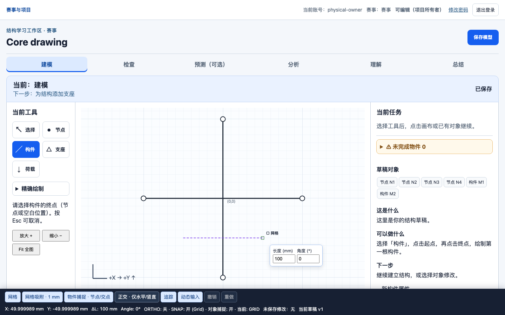
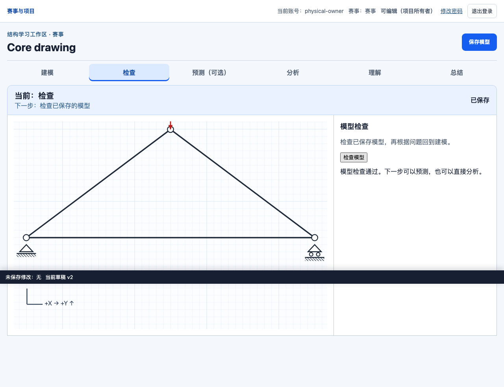
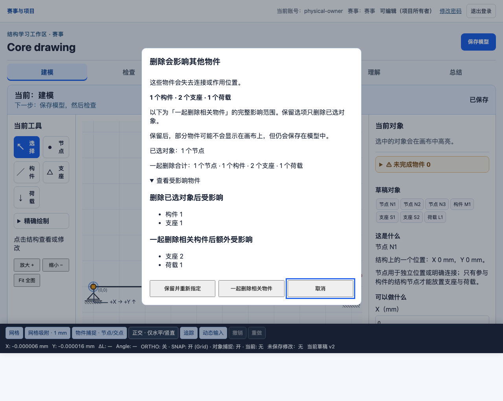

# Interactive Structural Analysis & Learning Platform

Student-first 2D truss modeling and engineering learning

An interactive 2D truss modeling, analysis, and learning platform designed for students participating in structural design competitions. It helps beginners connect modeling decisions with structural behavior, rather than replicating professional software such as MIDAS or SAP2000.

**Showcase prototype · Current stable mechanics: Linear Elastic 2D Truss**

## Why this project

For beginners, the challenge is not just obtaining a numerical answer. It is understanding how a physical structure maps to a model, where loads travel, which members carry tension or compression, and how supports affect deformation. Professional analysis tools can impose a steep learning curve before these ideas become clear.

This project connects **statics → mechanics of materials → structural analysis → competition application**, with student understanding in the foreground and the solver backstage.

## Core features

### Visual modeling

- Browser-based 2D workspace with a member-first path: choose Member, then click its start and end points.
- Node = Joint: members connect through explicit shared nodes or joint incidences; a geometric crossing alone is not a connection.
- Pinned and roller supports, nodal loads, material and section properties.
- 1 mm grid snap, ORTHO, node/intersection object snap, numerical input, Undo/Redo.
- Single/multiple selection, window selection and crossing selection.

### Draft and Model Check

- Save incomplete drafts while developing a model; incomplete models remain blocked from analysis.
- Model Check with concise explanations and navigation to the relevant recovery tools.
- Explicit impact-aware deletion supports iterative structural redesign without silently cascading related objects.
- **Keep & Reassign** preserves related draft objects for partial redesign; **Delete Related Objects** explicitly removes the previewed affected objects for a new build.

### Analysis

- Linear-elastic, small-displacement, axial-force-only 2D truss analysis.
- Nodal displacement, support reactions, member axial force, tension/compression, stress and mass.
- Canonical units: mm / N / MPa / g.

The numerical solver remains the mechanics authority. Browser interactions and explanations do not replace the numerical analysis.

### Learning experience

- Optional prediction before revealing results.
- Conclusion-first results, prediction comparison, “Why” explanations and technical data.
- Calculation report assistance, student design reasoning and reflection tied to an explicit analysis revision.

## Screenshots

These are real local regression screenshots using synthetic demo/test data. The student-facing interface currently uses Simplified Chinese. 中文界面面向结构设计竞赛初学者，强调建模、检查、分析与理解之间的联系。

### Modeling workspace

Member drawing with numerical input and snap feedback. The crossing illustrates geometry without an automatic joint.



### Model Check

A saved demonstration structure passes Model Check after an iterative rebuild.



### Delete Impact

The affected objects are previewed before choosing preservation, explicit related-object deletion or cancellation.



## Engineering design

- Django modular monolith with a pure Python mechanics core separated from the web layer.
- Immutable analysis revisions and snapshots keep historical results tied to their inputs.
- Node-as-Joint topology and an explicit draft lifecycle distinguish geometry, connectivity and incomplete work.
- Server-side Model Check before solver execution; browser recovery guidance is presentation/navigation, not a second validation authority.
- Browser-based CAD interactions backed by TDD, mechanics benchmarks and regression journeys.

See [the documentation index](docs/specs/README.md), [the truss solver contract](docs/specs/TRUSS_SOLVER_CONTRACT.md) and [known issues](docs/specs/POC_V1_KNOWN_ISSUES.md) for deeper engineering details.

## Technical stack

Python · Django · NumPy · Vanilla JavaScript · SVG · pytest · Playwright

## Installation and local demo

Use **Python 3.12 or newer**. From the repository root, create an isolated environment (macOS/Linux):

```bash
python3 -m venv .venv
source .venv/bin/activate
python -m pip install -e '.[web]'
python manage.py migrate
python manage.py seed_demo --confirm
python manage.py runserver 127.0.0.1:8000
```

On Windows, activate with `.venv\Scripts\Activate.ps1` in PowerShell instead of `source`.

Open `http://127.0.0.1:8000/events/` locally and sign in using the account information printed by `seed_demo`. The command creates a sample truss and a blank modeling project with `physical-draft-v2` in a fresh database, along with a demo material and section. It does not run an analysis or fabricate results. Existing projects are reused, not converted; use a fresh checkout/database for a clean demo.

The database is local and ignored by Git. Do not commit it. Playwright/Chromium is **not required to run the demo**. See [demo setup notes](docs/development/demo_setup.md).

### Development-only security notice

This repository includes development-only demo configuration. **Do not reuse the demo password or development SECRET_KEY in a public deployment.** The included configuration is for local demonstration, not production hosting.

## Development and verification

The project includes benchmarked mechanics tests, Django regression tests and browser-level Playwright journeys. Install test dependencies separately:

```bash
python -m pip install -e '.[web,test]'
python -m playwright install chromium
pytest -q -m 'not browser'
pytest tests/mechanics -q
pytest tests/browser -q -m browser
python manage.py check
python manage.py makemigrations --check --dry-run
git diff --check
```

On Linux, Playwright may also require browser system dependencies (`python -m playwright install --with-deps chromium`).

## Scope and limitations

This is an educational, competition-oriented prototype: **2D, linear elastic, small displacement, pin-jointed axial-member truss idealization**. It is not a substitute for professional structural engineering software and is not intended for real-world structural safety certification.

Frame bending, 3D, nonlinear analysis, automatic structural optimization, arbitrary-angle rollers, automatic Euler classification, and PDF/DOCX/Excel export are outside the current scope. AI is not the solver or mechanics authority.

## License

Copyright (c) 2026. All Rights Reserved. See [LICENSE](LICENSE) for the viewing and evaluation notice; this showcase is not offered under an open-source license.
