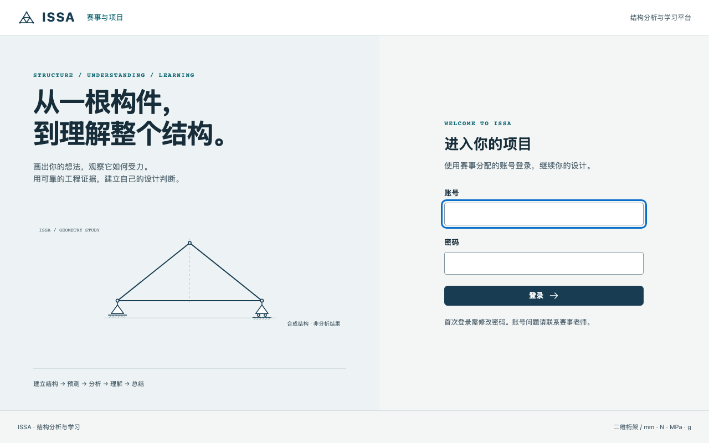
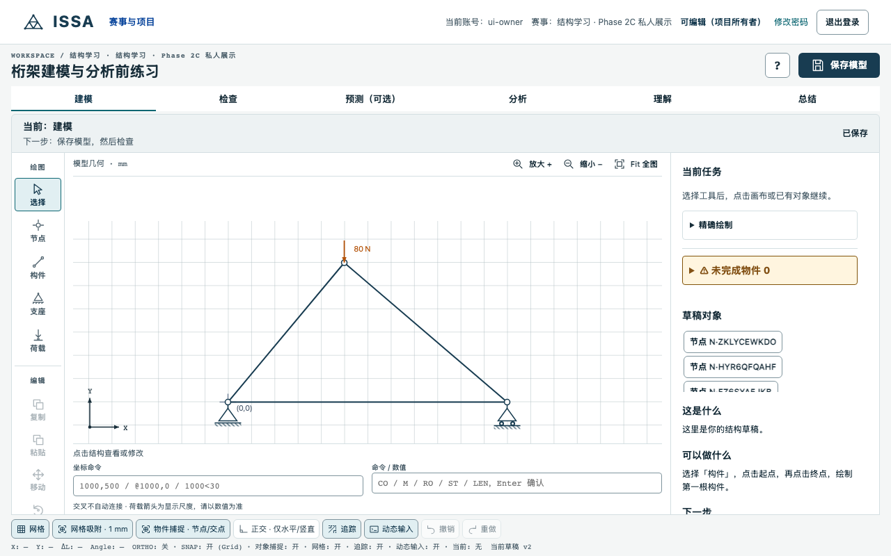
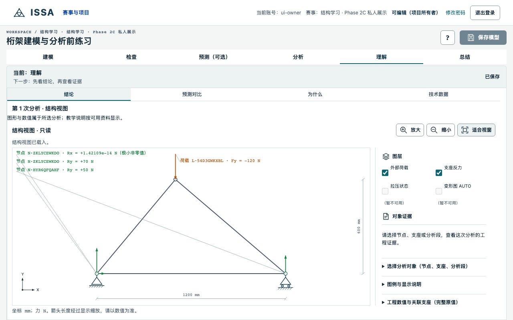
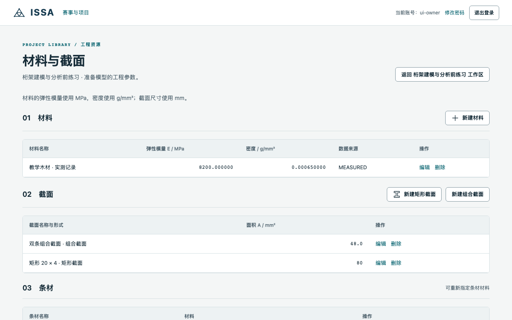
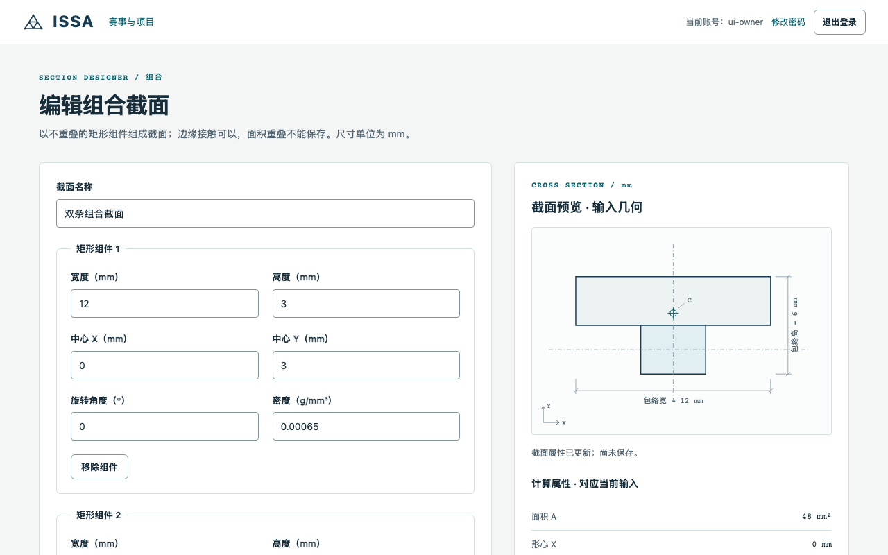
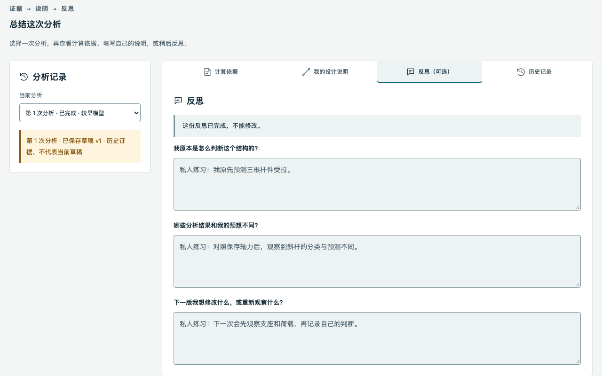

# ISSA｜互動式結構分析與學習平台

**為結構設計競賽初學者打造，從畫出模型到理解工程證據。**

ISSA 將 **建模 → 預測 → 分析 → 理解 → 反思** 串成同一個 Web 工作流程。學生能繪製結構、記錄自己的判斷，再對照可追溯的分析結果，整理設計說明與反思。

本專案著重教學、工程概念與競賽模型的可理解性；定位不同於 MIDAS、SAP2000 等商業通用結構分析軟體。產品介面使用**簡體中文**；本文以繁體中文說明，操作名稱保留產品原文。

> **UI/UX 已實作 · Final QA 已通過 · Owner Acceptance PENDING · Teacher Review DEFERRED**
> 目前為完整產品候選版，未宣稱正式部署、學術驗證或工程安全認證。

## 核心功能

|範圍|目前已實作能力|
|---|---|
|2D 建模與 CAD|節點／構件、明確接點關係、精確座標輸入、Copy／Move／Rotate／Stretch／Length、選取、Undo／Redo、Grid／Snap／ORTHO／Track／Dynamic，以及「?」快捷鍵說明與 X 右／Y 上方向圖|
|材料與截面|材料參數、矩形及組合截面、旋轉與形心預覽、條材材料指派、建立／編輯與刪除影響確認|
|支座與荷載|鉸支座、全域 X／Y 約束的滾支座、節點荷載，以及保存草稿與模型檢查／修復提示|
|工程求解|線彈性、小位移、軸力桿件的 **2D Truss** 分析；保留反力、軸力、位移、單位及完整數值|
|Results／AV-01|真實 Saved Run 結構圖、反力、拉壓分類、變形與 AUTO 倍率、圖層、縮放／全圖、Hover、Inspector、物件清單與原值證據|
|學習循環|可選的 Prediction、預測比較、Why 解釋、計算依據／報告、學生設計說明、反思與歷史 Run 選取|
|賽事與帳號|登入、首次改密、POST 退出、專案建立與繼續入口；授權管理者的參賽帳號新增／加入／恢復／停用、兩步確認與 CSV 開戶流程|

幾何交叉**不自動代表接點**。未完成的模型可以保存，但必須通過檢核才可分析。歷史選取使用同一個明確的 Run，不提供未實作的雙 Run 數值比較或 AI 評分。

## 產品畫面

以下是新版真實 Django 後端畫面，使用合成練習帳號與模型。Results 來自真正的 Saved Run；沒有將設計預覽或固定示意 SVG 冒充分析結果。

### 登入與建模





### 分析結果



<details>
<summary>材料、截面與反思畫面</summary>







</details>

## 技術架構

- **Django 後端**負責帳號、權限、資料生命週期、模型保存、分析協調與教學資料。
- **Django Templates + Vanilla JavaScript + SVG** 提供一般 SSR 頁面、CAD 操作、工程圖與結果呈現，沒有新增 SPA 或外部 CDN 依賴。
- **Mechanics Solver 與前端視覺化分離**：瀏覽器負責互動與展示，不是工程求解權威；教學解釋不取代數值分析。
- **Saved AnalysisRun／ModelRevision 是歷史結果權威**：數值及工程證據來自所選保存版本，不使用最新 Draft 補齊歷史事實。切換 Run 時清除舊證據，完成的反思維持不可修改規則。

```text
accounts/        登入、使用者角色與首次改密
competitions/    賽事、成員資格、兩步確認及 CSV 管理
materials/       材料、矩形／組合截面與條材
projects/        專案、Workspace 與前端 Static Assets
modeling/        物理模型、草稿與幾何資料
idealization/    物理結構至分析模型的轉換
mechanics/       線彈性 2D Truss 求解與驗證邊界
analysis/        分析協調、Saved Run 與 Revision
learning/        Prediction、Comparison、Explanation、Reasoning、Reflection
config/          Django 設定與路由
templates/       共用框架及 SSR 頁面
tests/           正式測試、必要 fixture 與瀏覽器旅程
docs/specs/      MASTER_SPEC 與正式規格
docs/superpowers/ 已批准／歷史設計及實作計畫
docs/releases/   公開版本狀態與 QA 摘要
```

實作邊界以 [MASTER_SPEC](docs/specs/MASTER_SPEC.md)、[架構規格](docs/specs/ARCHITECTURE_SPEC.md)及 [Truss Solver Contract](docs/specs/TRUSS_SOLVER_CONTRACT.md)為準。這些文件保留原始核准內容，最新交付狀態請看[版本摘要](docs/releases/UI_RELEASE_STATUS.md)。

## 安裝與本機啟動

### 系統需求

- Python **3.12 以上**；Final QA 使用 Python 3.13。
- Python 虛擬環境與 pip；一般使用只需要本機 SQLite。
- 現代桌面瀏覽器。執行產品不需要 Node.js、Playwright 或前端打包工具；部分開發測試另需 Node.js／Playwright。

依 [pyproject.toml](pyproject.toml) 安裝鎖定的 NumPy、Django 等依賴。以下為 macOS／Linux shell 指令；Windows 可用 PowerShell 的 `.venv\Scripts\Activate.ps1` 啟用環境，環境變數設定亦須換成 PowerShell 語法。

```bash
git clone --branch release/issa-ui-complete https://github.com/alan228922-crypto/ISSA.git
cd ISSA
python3 -m venv .venv
source .venv/bin/activate
python -m pip install -e '.[web]'
```

### 私密本機設定

[本機設定範例](config/local_settings.example.py)會讀取以下**實際已實作於範例**的環境變數：

|變數|用途|
|---|---|
|`DJANGO_SETTINGS_MODULE`|選用複製後的 `config.local_settings`|
|`ISSA_SECRET_KEY`|本機自行產生的 Django 密鑰，不寫入 Git|
|`ISSA_DB_PATH`|可選的本機 DB 路徑；未設定時使用專案內被 Git 忽略的 `db.sqlite3`|

```bash
cp config/local_settings.example.py config/local_settings.py
export DJANGO_SETTINGS_MODULE=config.local_settings
export ISSA_SECRET_KEY="$(python -c 'from django.core.management.utils import get_random_secret_key; print(get_random_secret_key())')"
# 若要使用其他全新私人 DB，可另外設定 ISSA_DB_PATH；勿指向既有 Runtime 的 DB。
python manage.py migrate
python manage.py check
```

這裡不依賴 `.env` 自動載入。若換新 shell，需再次提供自己的設定；不要在已有資料的環境隨意更換密鑰。範例沿用本機 DEBUG 模式並設定獨立 Cookie 名稱，**不是 production 設定**。正式部署不在本輪交付範圍。

### 初次使用：獨立本機示範

僅在**全新本機 DB** 執行：

```bash
python manage.py seed_demo --confirm
python manage.py changepassword demo_student
```

`seed_demo` 是既有的 DEBUG-only 指令，建立／重用示範帳號、材料、截面、預置模型及空白建模專案，不會偽造分析結果。請立即以第二個指令設定自己的密碼，不要將命令輸出的示範憑證用於正式環境或提交到 Git。

示範賽事初始為 `DRAFT`。若要體驗**完整反思**，請在這份獨立本機 DB 初始化為進行中的練習賽事；這是開發者的資料初始化，不是新增的學生操作或賽事建立頁：

```bash
python manage.py shell <<'PY'
from datetime import timedelta
from django.utils import timezone
from competitions.models import CompetitionEvent

event = CompetitionEvent.objects.get(event_code='DEMO-TRUSS-2026')
event.starts_at = timezone.now() - timedelta(days=1)
event.ends_at = timezone.now() + timedelta(days=30)
event.status = CompetitionEvent.Status.ACTIVE
event.save()
PY
python manage.py runserver 127.0.0.1:8000
```

開啟 <http://127.0.0.1:8000/accounts/login/>，以本機示範帳號及自己剛設定的密碼登入，從「赛事与项目」選擇專案。重複執行 seed 會重用既有資料，不會替已存在的帳號重設密碼。

賽事管理需具備既有 `MANAGER`／`DEVELOPER` 角色與相應賽事授權。專案沒有自助註冊或獨立賽事建立介面；請由組織者配置帳號與賽事，不應把 Django superuser 當作產品角色的替代品。

## 學生操作流程

1. **準備材料與截面**：從「管理材料与截面」建立或選用材料及截面，確認單位與資料來源。
2. **建模**：選擇「构件」並指定兩端，加入支座與節點荷載。交叉處若要傳力，須建立明確接點關係。
3. **保存與檢查**：保存草稿，執行「检查」，依提示修復缺漏；不能用未通過檢核的草稿直接分析。
4. **預測與分析**：記錄自己的受拉／受壓、位移位置等判斷，或跳過預測後執行「分析」。預測是軟門檻，不是 AI 評分。
5. **理解工程證據**：先看結論，再以圖層、Hover、Inspector、完整原值、Why 與「预测对比」檢查依據。箭頭長度及變形倍率屬顯示縮放，以數值與單位為準。
6. **整理與反思**：在「总结」中選定同一次分析，閱讀計算依據，填寫自己的設計說明與反思。完成反思後不能修改；切換歷史 Run 時留意 STALE／只讀提示。

## 工程假設與限制

- 核心為 **2D、線彈性、小位移、鉸接軸力桿件的 Truss**；單位採 **mm／N／MPa／g**。
- 不等同完整 2D Frame 或 3D FEM；不提供未實作的彎矩、剪力、屈曲破壞或安全認證能力。
- 不提供任意角度 Roller、非線性分析、自動最佳化、Euler 安全判定或 PDF／Word／Excel 匯出。
- 拉壓與 MIXED 等教學分類保留原本語意；極小非零值不可當成精確零，PARTIAL／UNAVAILABLE 與必要精度警告不可省略。
- AI 不作為工程求解權威；分析與教學結果不能取代正式工程設計審查。

## 驗證與專案狀態

全站 UI/UX 改版已實作並核對 38 項介面。已完成的 Final QA 為：

|獨立 Suite|結果|
|---|---|
|Full Browser|803 passed；0 failed／0 skipped|
|Full Non-browser|1,018 passed；0 failed／0 skipped|
|Mechanics|131 passed；0 failed／0 skipped|
|Django System Check／Migration Check|通過|

Mechanics 與 Non-browser 重疊，**不能相加成獨立案例總數**。本輪只做包裝與輕量檢查，沿用上述已驗證 RC，沒有重新執行完整 Suite。

歷史 22 項 concurrency skips 已在隔離文件型 SQLite 下實際執行；**歷史 memory-SQLite HTTP500／IndexError 風險仍屬已知限制，未宣稱修復**。原始 QA 證據保留於來源分支，公開版本只保留必要摘要與少量畫面。詳見[版本與 QA 摘要](docs/releases/UI_RELEASE_STATUS.md)。

開發測試的依賴可用 `python -m pip install -e '.[web,test]'` 安裝；瀏覽器旅程另需 `python -m playwright install chromium`，部分 JavaScript 模組檢查需 Node.js。測試設定與範圍見 [TEST_ARCHITECTURE](docs/specs/TEST_ARCHITECTURE.md)。不要讓測試連到自己的既有私人 DB，也不要將 targeted rerun 當作完整 QA。

**尚待：Owner Acceptance PENDING；Teacher Review DEFERRED。** 沒有宣稱 Owner PASS、Teacher PASS 或 production 認證。

## 授權

目前 [LICENSE](LICENSE) 為 **All Rights Reserved**，原始碼公開供檢視與評估；公開 Repository 不等於已採用 OSI 開源授權。本輪沒有擅自變更授權。
